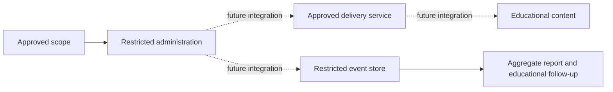

# Architecture and trust boundaries

This is a conceptual architecture. Only static content, synthetic fixtures and scaffold validation are implemented.

| Component | Proposed role | Public scaffold |
|---|---|---|
| Campaign framework, such as GoPhish | Manage an approved exercise | Not installed or configured |
| Reverse proxy, such as Nginx | Transport protection and permitted routes | Integration notes |
| Optional tunnel connector | Controlled ingress | Integration notes |
| Delivery provider | Send within approved scope and limits | No provider account or delivery code |
| Landing content | Educational follow-up | Neutral static HTML |
| Reporting | Summarize agreed measures | Fabricated aggregate JSON |

Keep administration behind an approved access boundary. A tunnel alone is not authorization. Scope service permissions, store secrets outside source control, separate landing content from management APIs, and protect recipient/event stores.

An operational lab must validate routes, access decisions, logging, delivery limits, stop procedures and removal of temporary access. These controls are proposed, not deployed here.
